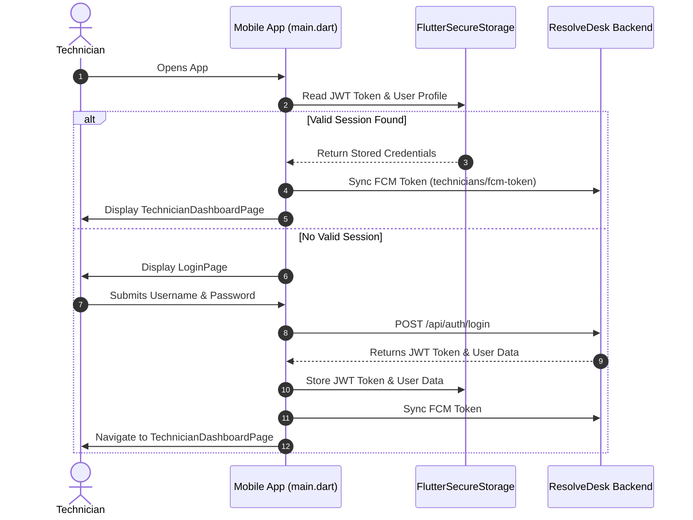
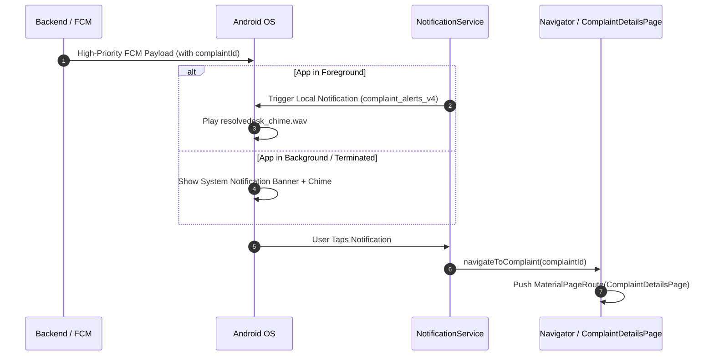
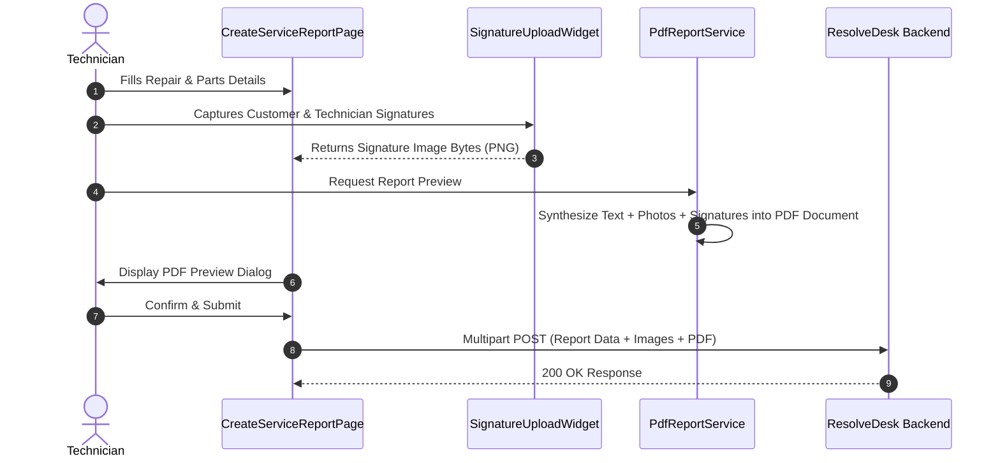

# ResolveDesk Mobile App — System Architecture Specification

## 1. Executive Summary

**ResolveDesk Mobile App** is a mobile application built with Flutter (Dart) designed for field service technicians to handle customer complaints, conduct site visits, update ticket statuses, capture media and digital signatures, generate PDF service and installation reports, and receive real-time push notification alerts for assigned jobs.

---

## 2. System Architecture Diagram

```mermaid
graph TD
    subgraph Client Application (Flutter Mobile)
        UI[Presentation Layer / Pages]
        WIDGETS[Reusable Custom Widgets]
        SERVICES[Service Layer / Business Logic]
        NETWORK[Network & Storage Layer]
    end

    subgraph Firebase Cloud
        FCM[Firebase Cloud Messaging]
    end

    subgraph Backend Services
        API[ResolveDesk REST API Engine]
        DB[(Central Database)]
    end

    UI --> WIDGETS
    UI --> SERVICES
    SERVICES --> NETWORK
    NETWORK -->|HTTPS / REST API| API
    API --> DB
    FCM -->|Push Notifications| SERVICES
    API -->|Send Alert Payload| FCM
```

---

## 3. Layered Architecture Breakdown

The application follows a clean 4-tier mobile architecture separating UI Presentation, Components, Services, and Data/Storage.

```
lib/
├── config/             # Network & API configurations, Base URLs, Secure Storage
├── main.dart           # Application Entry point, Session Bootstrapping & Theme setup
├── pages/              # UI Screen Components (Controllers + Views)
├── services/           # Async Business Services (FCM, PDF Generation, App Updates)
└── widgets/            # Reusable UI Components (Signature Pad, PDF Dialogs)
```

### A. Presentation Layer (`lib/pages/`)
- **[`LoginPage`](file:///C:/Jagdeesh/resolvedesk_mobileapp/lib/pages/login_page.dart)**: User authentication form, credential validation, token retrieval.
- **[`TechnicianDashboardPage`](file:///C:/Jagdeesh/resolvedesk_mobileapp/lib/pages/technician_dashboard_page.dart)**: Primary hub displaying assigned complaint metrics, status filters (Pending, In Progress, Resolved), search bar, and navigation drawer.
- **[`ComplaintDetailsPage`](file:///C:/Jagdeesh/resolvedesk_mobileapp/lib/pages/complaint_details_page.dart)**: Detailed job view displaying customer metadata, equipment serial numbers, status updates, photo uploads, and report creation triggers.
- **[`CreateServiceReportPage`](file:///C:/Jagdeesh/resolvedesk_mobileapp/lib/pages/create_service_report_page.dart)** & **[`CreateInstallationReportPage`](file:///C:/Jagdeesh/resolvedesk_mobileapp/lib/pages/create_installation_report_page.dart)**: Dynamic forms for recording repair actions, parts replacements, warranty details, and customer sign-off.
- **[`ServiceCallReportsPage`](file:///C:/Jagdeesh/resolvedesk_mobileapp/lib/pages/service_call_reports_page.dart)** & **[`InstallationReportsPage`](file:///C:/Jagdeesh/resolvedesk_mobileapp/lib/pages/installation_reports_page.dart)**: Historical lists of generated reports with PDF viewing and sharing capabilities.
- **[`EnquiriesPage`](file:///C:/Jagdeesh/resolvedesk_mobileapp/lib/pages/enquiries_page.dart)**: Customer pre-service query handling interface.

### B. Reusable Widgets (`lib/widgets/`)
- **[`SignatureUploadWidget`](file:///C:/Jagdeesh/resolvedesk_mobileapp/lib/widgets/signature_upload_widget.dart)**: Interactive touch canvas for collecting digital signatures from technicians and customers.
- **[`ServiceReportPreviewDialog`](file:///C:/Jagdeesh/resolvedesk_mobileapp/lib/widgets/service_report_preview_dialog.dart)** & **[`InstallationReportPreviewDialog`](file:///C:/Jagdeesh/resolvedesk_mobileapp/lib/widgets/installation_report_preview_dialog.dart)**: PDF document preview dialogs before final submission and sharing.

### C. Services & Business Logic Layer (`lib/services/`)
- **[`NotificationService`](file:///C:/Jagdeesh/resolvedesk_mobileapp/lib/services/notification_service.dart)**:
  - Manages FCM initialization, foreground banners, and background push handlers.
  - Registers Android `complaint_alerts_v4` notification channel with high priority and custom audio (`resolvedesk_chime.wav`).
  - Implements deep-link navigation directly to `ComplaintDetailsPage` when notification alerts are clicked.
- **[`PdfReportService`](file:///C:/Jagdeesh/resolvedesk_mobileapp/lib/services/pdf_report_service.dart)**: Generates PDF documents containing company branding, job parameters, photos, and digital signatures using `pdf` and `printing` packages.
- **[`AppUpdateService`](file:///C:/Jagdeesh/resolvedesk_mobileapp/lib/services/app_update_service.dart)**: Evaluates version numbers against the server to prompt Over-The-Air app updates.

### D. Data & Storage Layer (`lib/config/`)
- **[`ApiConfig`](file:///C:/Jagdeesh/resolvedesk_mobileapp/lib/config/api_config.dart)**:
  - Centralizes API base endpoints with environment switching (production server vs. development local network).
  - Encapsulates `FlutterSecureStorage` for encrypted persistence of JWT tokens and user profile JSON.
  - Factory method `getDio()` injects Bearer authorization headers and timeouts into HTTP requests.

---

## 4. Key Application Data Flows

### 4.1 Authentication & Session Lifecycle



---

### 4.2 Push Notification & Deep Link Flow



---

### 4.3 Report Generation & Signature Workflow



---

## 5. Native Android System Integration

- **Android Audio Resources**: Native sound files located in `android/app/src/main/res/raw/`:
  - `resolvedesk_chime.wav`: Custom notification alert sound.
  - `complaint_alert.wav`: Alternative high-priority alert chime.
- **Android Permissions ([`AndroidManifest.xml`](file:///C:/Jagdeesh/resolvedesk_mobileapp/android/app/src/main/AndroidManifest.xml))**:
  - `INTERNET` & `ACCESS_NETWORK_STATE`: API communication.
  - `POST_NOTIFICATIONS`: Android 13+ (API 33) runtime notification permission.
  - `CAMERA` & `READ_EXTERNAL_STORAGE` / `READ_MEDIA_IMAGES`: Photo capture and attachment.
  - `VIBRATE` & `RECEIVE_BOOT_COMPLETED`: Notification alerts.

---

## 6. Technology Stack Summary

| Layer | Technology / Library | Description |
| :--- | :--- | :--- |
| **Framework** | Flutter 3.x / Dart 3.x | Cross-platform mobile development framework |
| **Networking** | `dio: ^5.11.0` | HTTP client with interceptors and timeout configuration |
| **Local Storage** | `flutter_secure_storage: ^11.0.0` | Encrypted key-value storage for JWT tokens |
| **Push Messaging** | `firebase_messaging: ^16.6.0` | Cloud push notification receiver |
| **Local Alerts** | `flutter_local_notifications: ^22.3.0` | Native notification banner and audio handling |
| **Document Export** | `pdf: ^3.13.0` & `printing: ^5.15.0` | Vector PDF document generation and printing |
| **Image Handling** | `image_picker: ^1.1.2` | Camera and gallery photo selector |
| **UI Effects** | `skeletonizer: ^3.0.0` & `flutter_animate: ^4.5.2` | Loading skeletons and smooth visual transitions |
